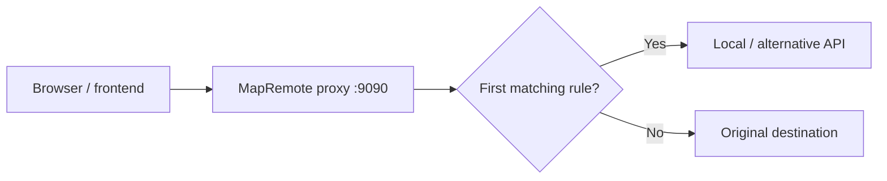

<div align="center">
  
  <h1>MapRemote</h1>
  <p><strong>Redirect requests. Keep your frontend unchanged.</strong></p>
  <p>A focused macOS development proxy for mapping remote HTTP and HTTPS endpoints to local or alternative backends.</p>
  <p>
    <a href="https://github.com/abdulsalamalkhatib96/MapRemote/actions/workflows/ci.yml"></a>
    
    
    
    
  </p>
  <p><a href="#quick-start">Quick start</a> · <a href="#mapping-rules">Mapping rules</a> · <a href="#architecture">Architecture</a> · <a href="#troubleshooting">Troubleshooting</a></p>
</div>

## Why MapRemote?

Develop a local API against an existing frontend without changing its environment variables, deployed configuration or request URLs. MapRemote applies ordered URL-mapping rules to traffic from proxy-aware applications and forwards matching requests to the backend of your choice.



MapRemote is deliberately narrow in scope: it provides a rule editor, mapping preview, automatic system proxy management, and explicit HTTPS certificate controls. It is not a general-purpose traffic inspection suite, and is not affiliated with Proxyman or mitmproxy.

## Features

| Capability | Description |
| --- | --- |
| HTTP and HTTPS mapping | Rewrite scheme, host, port and path for matching requests. HTTPS requires trusted local CA. |
| Exact and prefix paths | Match a single endpoint or preserve the suffix of an API subtree. |
| Wildcard source hosts | Match subdomains such as `*.example.com`. |
| Method filtering | Apply a rule to all methods or a selected HTTP method. |
| Query strings | Preserve the original query or replace it with the destination query. |
| Host header | Optionally keep the original Host header. |
| Rule priorities | First enabled matching rule wins; reorder rules from the interface. |
| Live rule updates | Persist and reload mapping configuration without restarting the engine. |
| Preview | Evaluate a URL without sending a network request. |
| macOS integration | Start and Stop manage HTTP/HTTPS system proxy settings automatically. |
| Recovery | A privileged supervisor journals previous settings and watches controller and engine processes. |
| HTTPS trust | Explicit certificate installation and removal controls. |

## Quick start

### Install from a DMG (no external runtime)

Open the [Releases page](https://github.com/abdulsalamalkhatib96/MapRemote/releases). Select the DMG for your Mac:

| Mac | File |
| --- | --- |
| Apple Silicon (M-series) | `MapRemote-3.0.1-arm64.dmg` |
| Intel | `MapRemote-3.0.1-x86_64.dmg` |

Mount the disk image, drag MapRemote to Applications, eject the disk image, and open the application. The distribution contains its own relocatable CPython 3.12 and mitmproxy 12.3.1. No Homebrew, Terminal, system Python or separate mitmproxy installation is needed on the destination Mac. The two architectures are built natively, not a single universal binary. macOS 12 is the deployment target; automated native builds run on macOS 15 and earlier systems still require compatibility verification.

**Release status:** the distribution workflow publishes an explicitly labeled ad-hoc-signed preview only after both architecture builds and smoke tests pass. Such a preview is not Apple-notarized. A signed and notarized release requires the owner's Apple Developer ID credentials. Do not disable Gatekeeper or SIP; review the source before using Apple's [per-app approval process](https://support.apple.com/en-us/102445) for a trusted preview.

### Build from source (developers only)

On a Mac with Apple Command Line Tools and Python 3 installed:

```bash
git clone https://github.com/abdulsalamalkhatib96/MapRemote.git
cd MapRemote
MAPREMOTE_BUILD_ONLY=1 bash Build.command
python3 scripts/test-bundle.py MapRemote.app
bash scripts/package-dmg.sh
```

The build downloads a pinned redistributable CPython archive from [Python Build Standalone](https://github.com/astral-sh/python-build-standalone), verifies the upstream SHA-256 digest, installs mitmproxy and binary-wheel dependencies into the bundle, records resolved package versions, compiles the native components and signs the bundle. It requires Internet access at build time only. The final app contains the runtime, proxy engine and application resources. See [Distribution guide](docs/DISTRIBUTION.md) for signing, notarization, CI, licensing and recovery details.

### First run

1. Quit other debugging proxies and stop any manually launched `mitmdump` process.
2. MapRemote automatically adopts an abandoned manual loopback proxy on the configured port; no manual reset is required for that case. A different active proxy or PAC/SOCKS configuration is not overwritten.
3. Open MapRemote, add a rule, and click **Start proxy**. Approve the administrator prompt.
4. For HTTPS, click **Install & Trust Certificate** after the CA has been generated. Review and approve the macOS trust prompt; use Keychain Access if interactive trust cannot be granted by the button.
5. Test your request from a proxy-aware client. Click **Stop** or quit when finished.

## Mapping rules

### Example: local Laravel API

Assume a frontend calls `https://api.example.com/v1/users?page=2` and your local API is running at port 8000.

| Field | Value |
| --- | --- |
| Name | Local Laravel API |
| Source URL | `https://api.example.com/v1` |
| Destination URL | `http://127.0.0.1:8000/api` |
| Path match | Prefix |
| HTTP method | All methods |
| Query string | Preserve original |
| Keep original Host | Off (unless required by the backend) |

The forwarded URL becomes:

```text
http://127.0.0.1:8000/api/users?page=2
```

The browser continues requesting the original URL. The local backend must still satisfy any relevant CORS, cookie, authentication and response requirements. Mapping does not bypass browser security or certificate pinning.

### Rule semantics

HTTPS interception is limited to enabled HTTPS source authorities (hostname and port). Other TLS connections are tunneled without replacing their certificates, including when mapping is disabled. HTTPS paths on a selected authority still require the MapRemote CA; changes to interception scope affect new connections, so reconnect a client after editing rules if necessary. HTTP requests that do not match a rule are forwarded unchanged. The source scheme, host and effective port must match. Prefix matching respects path segment boundaries (`/api` does not match `/apix`). Wildcards are allowed only at the start of the source hostname and do not match the bare parent domain. Source query matching is not supported. The rule list is evaluated top to bottom and the first enabled matching rule wins. Disable the mapping tool to forward requests unchanged, or stop the proxy to restore system settings.

## Architecture

| Component | Responsibility |
| --- | --- |
| `NativeApp.swift` | AppKit window and embedded WebKit interface; launches the bundled Python controller. |
| `index.html` | Rule editor, preview and lifecycle controls. |
| `app.py` | Loopback control API, engine startup, diagnostics and shutdown. |
| `rules.py` | Validation, deterministic mapping and atomic JSON persistence. |
| `addon.py` | mitmproxy request-header hook and live rule reload. |
| `system_proxy.py` | Administrator prompts, helper supervision and certificate actions. |
| `ProxyHelper.swift` | SystemConfiguration changes, recovery journal and PID monitoring. |
| `smoke_test.py` | Real loopback HTTP and HTTPS mapping test with temporary CA. |
| `assets/` | Original vector icon and 1024px raster source. |

The proxy listens on `127.0.0.1:9090` by default. The controller uses an ephemeral loopback port, a session token, and Host/Origin checks. Rules and CA material remain local:

```text
~/Library/Application Support/MapRemote/
├── rules.json
├── ca/
└── instance.lock
```

The privileged helper stores a root-owned recovery journal at `/private/var/db/com.mapremote.proxy/snapshot.plist`. Do not manually delete it. Enabled Wi-Fi/Ethernet services in the current network location are managed; existing bypass entries are retained. Active unrelated manual, PAC/WPAD or SOCKS proxies cause a safe refusal instead of being silently replaced. An abandoned matching loopback proxy is adopted and disabled on Stop rather than restored to a dead listener. Restoration compares coherent proxy-setting groups independently to preserve unrelated edits without leaving HTTP/HTTPS enabled accidentally. Immediate recovery after power loss or simultaneous supervisor failure is not guaranteed; reopen MapRemote and use **Recover network settings**.

## Testing

```bash
python3 -m unittest discover -s tests -v
python3 smoke_test.py # source development with mitmproxy installed
MAPREMOTE_BUILD_ONLY=1 bash Build.command # macOS only
python3 scripts/test-bundle.py MapRemote.app
codesign --verify --deep --strict --verbose=2 MapRemote.app
```

The smoke tests use a temporary CA, temporary rules and a loopback server without modifying system proxy settings or system trust. The distribution workflow tests a relocated signed bundle using its own runtime on Apple Silicon and Intel before publishing DMGs. Privileged network changes, HTTPS trust prompts, crash recovery and end-to-end native UI behavior still require manual testing on a Mac. CI configuration is not evidence of a successful run.

## Troubleshooting

| Error / symptom | Action |
| --- | --- |
| Proxy port is already in use | Run `lsof -nP -iTCP:9090 -sTCP:LISTEN`; stop only the confirmed conflicting process or choose another port. |
| `mitmdump` not found | Reinstall MapRemote from a complete DMG. Developers running source code can install mitmproxy separately. |
| Proxy exits during startup | Read the engine diagnostics in the UI. Source developers can run the bundled relocation test. |
| Addon collision or `Loader` error | Quit the old app and rebuild from current source; the app embeds its own addon. |
| Helper killed before readiness (status 137) | Install 3.0.1 or later; if it persists inspect Console for CODESIGNING/AMFI reports. Do not disable Gatekeeper or SIP. |
| `nohup: can't detach from console` | Rebuild using 2.5 or later; this version no longer uses nohup. |
| Certificate authorization denied | Use Keychain Access to inspect the exact generated public CA certificate and approve trust interactively. |
| Internet stops working | Use Recover network settings, then verify Network > Details > Proxies; do not remove the journal. |
| Request is not mapped | Check the rule preview, source scheme/port, priority, bypass entries and client proxy support. |

## Security and limitations

- Intended only for authorized local development; HTTPS inspection grants trust to a local CA. Protect the private CA key and remove trust when it is no longer needed.
- A matching request can forward its original authorization headers, cookies and body to a different destination. Never map sensitive traffic to an untrusted backend.
- No request capture UI or persistent flow logging is provided. The underlying proxy still processes request content.
- Applications that ignore system proxy settings, pinned TLS clients, VPN/custom network services and proxy-bypassed destinations may not work.
- Standalone packaging does not imply Apple notarization or a complete security audit. Check the exact release's signing status. Privileged UI integration and system trust still require manual Mac validation.

See [SECURITY.md](SECURITY.md) for responsible disclosure and [CONTRIBUTING.md](CONTRIBUTING.md) for development guidelines.

## Changelog and roadmap

See [CHANGELOG.md](CHANGELOG.md) for version history. The 3.0 distribution pipeline builds self-contained architecture-specific DMGs; Apple Developer credentials are required to produce notarized releases. Future work includes broader OS coverage and additional privileged integration testing.

## Author and licensing

Developed for [Abdulsalam Al-Khatib](https://github.com/abdulsalamalkhatib96). Powered by [mitmproxy](https://github.com/mitmproxy/mitmproxy), Swift and Python. Third-party components retain their respective licenses.

No license has been selected for MapRemote itself. Public source visibility alone does not grant permission to redistribute or modify it; contact the owner for licensing terms.
